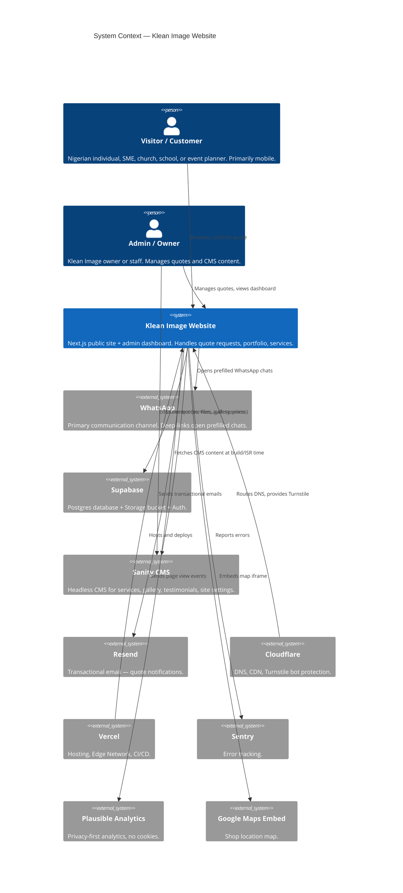
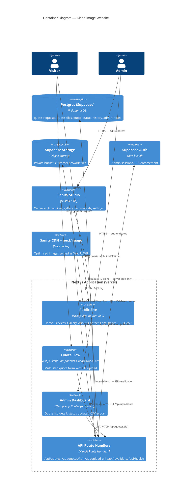
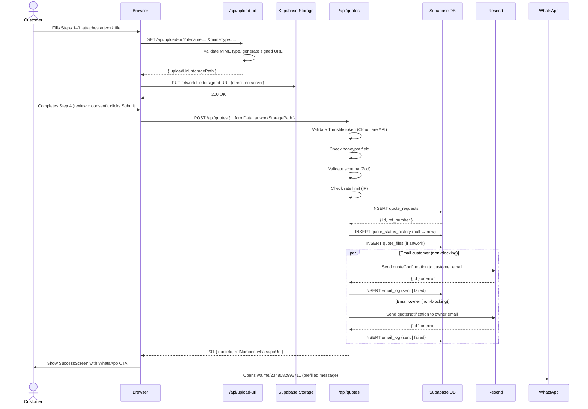
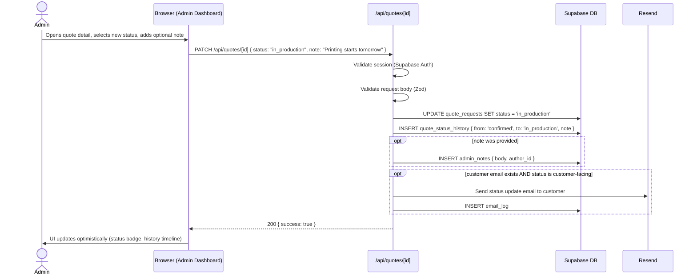

# Design — Klean Image Creative Printing Solutions
**Version:** 1.0  
**Date:** 09 November 2026  
**Status:** DRAFT — awaiting client approval

---

## Table of Contents
1. [System Context Diagram](#1-system-context-diagram)
2. [Container Diagram](#2-container-diagram)
3. [Folder Structure](#3-folder-structure)
4. [Design Tokens](#4-design-tokens)
5. [Database Schema](#5-database-schema)
6. [Row Level Security Policies](#6-row-level-security-policies)
7. [Sanity CMS Schemas](#7-sanity-cms-schemas)
8. [API Contracts](#8-api-contracts)
9. [Component Tree](#9-component-tree)
10. [Sequence Diagrams](#10-sequence-diagrams)
11. [Environment Variables](#11-environment-variables)
12. [Error Handling Strategy](#12-error-handling-strategy)
13. [Caching and Revalidation Strategy](#13-caching-and-revalidation-strategy)
14. [Security Headers](#14-security-headers)
15. [Phase 2 Scaffold Design](#15-phase-2-scaffold-design)
16. [Decision Log (ADRs)](#16-decision-log-adrs)
17. [Cost Estimate](#17-cost-estimate)

---

## 1. System Context Diagram



---

## 2. Container Diagram



---

## 3. Folder Structure

```
kleanimage/
├── .github/
│   └── workflows/
│       └── ci.yml                  # lint, typecheck, test, build
├── .husky/
│   ├── pre-commit                  # lint-staged
│   └── commit-msg                  # conventional commits check
├── .kiro/                          # Kiro IDE spec files
├── e2e/                            # Playwright end-to-end tests
│   ├── quote-flow.spec.ts
│   ├── admin-login.spec.ts
│   └── navigation.spec.ts
├── public/
│   ├── logo.svg                    # SVG version of Klean Image logo
│   ├── logo.png                    # PNG fallback
│   ├── favicon.ico
│   ├── apple-touch-icon.png
│   ├── og-default.jpg              # Default Open Graph image (1200×630)
│   └── robots.txt
├── sanity/                         # Sanity Studio (separate workspace)
│   ├── sanity.config.ts
│   ├── schemas/
│   │   ├── service.ts
│   │   ├── galleryItem.ts
│   │   ├── testimonial.ts
│   │   ├── siteSettings.ts
│   │   ├── faq.ts
│   │   └── index.ts
│   └── package.json
├── src/
│   ├── app/
│   │   ├── layout.tsx              # Root layout (fonts, providers, analytics)
│   │   ├── not-found.tsx
│   │   ├── error.tsx
│   │   ├── (public)/               # Route group — public pages (no auth)
│   │   │   ├── page.tsx            # Home
│   │   │   ├── services/
│   │   │   │   ├── page.tsx        # Services listing
│   │   │   │   └── [slug]/
│   │   │   │       └── page.tsx    # Individual service
│   │   │   ├── gallery/
│   │   │   │   └── page.tsx
│   │   │   ├── about/
│   │   │   │   └── page.tsx
│   │   │   ├── contact/
│   │   │   │   └── page.tsx
│   │   │   ├── quote/
│   │   │   │   └── page.tsx        # Multi-step quote form
│   │   │   └── legal/
│   │   │       ├── privacy/
│   │   │       │   └── page.tsx
│   │   │       ├── terms/
│   │   │       │   └── page.tsx
│   │   │       └── refund-policy/
│   │   │           └── page.tsx
│   │   ├── (admin)/                # Route group — protected
│   │   │   ├── layout.tsx          # Auth guard, admin shell
│   │   │   ├── admin/
│   │   │   │   ├── login/
│   │   │   │   │   └── page.tsx
│   │   │   │   ├── quotes/
│   │   │   │   │   ├── page.tsx    # Quote dashboard list
│   │   │   │   │   └── [id]/
│   │   │   │   │       └── page.tsx # Quote detail
│   │   │   │   └── settings/
│   │   │   │       └── page.tsx    # Owner-only: manage staff, etc.
│   │   └── api/
│   │       ├── quotes/
│   │       │   ├── route.ts        # POST — create quote
│   │       │   └── [id]/
│   │       │       └── route.ts    # GET, PATCH — view/update quote
│   │       ├── upload-url/
│   │       │   └── route.ts        # GET — generate signed upload URL
│   │       ├── export-quotes/
│   │       │   └── route.ts        # GET — CSV export (admin)
│   │       ├── revalidate/
│   │       │   └── route.ts        # POST — CMS webhook revalidation
│   │       └── health/
│   │           └── route.ts        # GET — uptime check
│   ├── components/
│   │   ├── ui/                     # shadcn/ui primitives (Button, Input, etc.)
│   │   ├── sections/               # Page sections (Hero, ServicesGrid, etc.)
│   │   │   ├── Hero.tsx
│   │   │   ├── ServicesOverview.tsx
│   │   │   ├── HowItWorks.tsx
│   │   │   ├── FeaturedWork.tsx
│   │   │   ├── Testimonials.tsx
│   │   │   ├── CtaBanner.tsx
│   │   │   └── MapEmbed.tsx
│   │   ├── forms/                  # Form components
│   │   │   ├── QuoteForm/
│   │   │   │   ├── index.tsx       # Orchestrates steps
│   │   │   │   ├── Step1Product.tsx
│   │   │   │   ├── Step2Finish.tsx
│   │   │   │   ├── Step3Contact.tsx
│   │   │   │   ├── Step4Review.tsx
│   │   │   │   └── SuccessScreen.tsx
│   │   │   └── AdminNoteForm.tsx
│   │   └── layout/
│   │       ├── Navbar.tsx
│   │       ├── Footer.tsx
│   │       ├── FloatingWhatsApp.tsx
│   │       ├── MobileCTABar.tsx
│   │       └── AdminShell.tsx
│   ├── lib/
│   │   ├── supabase/
│   │   │   ├── client.ts           # Browser Supabase client
│   │   │   ├── server.ts           # Server-side Supabase client (service role)
│   │   │   └── admin.ts            # Admin-scoped queries
│   │   ├── sanity/
│   │   │   ├── client.ts           # Sanity client config
│   │   │   ├── queries.ts          # GROQ query definitions
│   │   │   └── image.ts            # Sanity image URL builder
│   │   ├── email/
│   │   │   ├── resend.ts           # Resend client init
│   │   │   ├── templates/
│   │   │   │   ├── quoteConfirmation.tsx  # Customer email
│   │   │   │   └── quoteNotification.tsx  # Owner email
│   │   ├── whatsapp/
│   │   │   └── buildMessage.ts     # Builds prefilled wa.me URLs
│   │   ├── validation/
│   │   │   └── rateLimit.ts        # Upstash or in-memory rate limiter
│   │   └── csv/
│   │       └── exportQuotes.ts     # Quote → CSV serialiser
│   ├── schemas/                    # Zod schemas — shared client + server
│   │   ├── quote.ts                # QuoteRequestSchema, QuoteUpdateSchema
│   │   ├── phone.ts                # Nigerian phone normalisation
│   │   └── uploadFile.ts           # File type/size validation
│   ├── types/
│   │   ├── quote.ts                # QuoteRequest, QuoteStatus, etc.
│   │   ├── sanity.ts               # Sanity document types (generated)
│   │   └── supabase.ts             # Supabase generated types
│   └── config/
│       ├── services.ts             # Static service slug → name map (fallback)
│       ├── site.ts                 # Site-wide constants (name, URL, WhatsApp no.)
│       └── featureFlags.ts         # Phase 2 feature flags
├── .env.example
├── .eslintrc.json
├── .prettierrc
├── next.config.ts
├── tailwind.config.ts
├── tsconfig.json
├── vitest.config.ts
├── playwright.config.ts
└── package.json
```

---

## 4. Design Tokens

Extracted from the Klean Image logo. Defined in `tailwind.config.ts` under `theme.extend.colors`.

```typescript
// tailwind.config.ts
colors: {
  brand: {
    magenta:  '#E91E8C',  // Primary CTA, headings accent, "IMAGE" wordmark colour
    cyan:     '#00AEEF',  // Secondary accent, links, icons
    yellow:   '#FFE600',  // Highlight, badge backgrounds
    dark:     '#1A1A1A',  // Body text, "KLEAN" wordmark colour
    white:    '#FFFFFF',
    'gray-50':  '#F9FAFB',
    'gray-100': '#F3F4F6',
    'gray-200': '#E5E7EB',
    'gray-500': '#6B7280',
    'gray-700': '#374151',
  }
}

// Typography
fontFamily: {
  sans: ['Inter', 'system-ui', 'sans-serif'],  // Body
  display: ['Montserrat', 'sans-serif'],        // Headlines — bold, clean, similar to logo
}
```

**Contrast checks (WCAG 2.1 AA):**
- `#E91E8C` on `#FFFFFF` → ratio 4.6:1 ✓ (normal text)
- `#FFFFFF` on `#E91E8C` → ratio 4.6:1 ✓ (button labels)
- `#1A1A1A` on `#FFFFFF` → ratio 16.1:1 ✓
- `#00AEEF` on `#FFFFFF` → ratio 3.0:1 — use only for large text or icons, not body text

---

## 5. Database Schema

### 5.1 Enums

```sql
CREATE TYPE quote_status AS ENUM (
  'new',
  'quoted',
  'confirmed',
  'in_production',
  'ready',
  'delivered',
  'cancelled'
);

CREATE TYPE delivery_method AS ENUM ('pickup', 'delivery');

CREATE TYPE admin_role AS ENUM ('owner', 'staff');
```

### 5.2 Tables

#### `quote_requests`

```sql
CREATE TABLE quote_requests (
  id               UUID PRIMARY KEY DEFAULT gen_random_uuid(),
  ref_number       TEXT NOT NULL UNIQUE,         -- e.g. KI-2026-0001
  
  -- Product
  service_slug     TEXT NOT NULL,                -- e.g. 'business-cards'
  service_name     TEXT NOT NULL,                -- denormalised for display
  size             TEXT,                         -- e.g. 'A4', '3.5x2 inches', 'Custom'
  quantity         INTEGER NOT NULL CHECK (quantity > 0),
  
  -- Finish
  paper_finish     TEXT,                         -- e.g. 'Matte 350gsm', 'Gloss 250gsm'
  finish_options   TEXT,                         -- e.g. 'Spot UV', 'Lamination'
  deadline         DATE NOT NULL,
  delivery_method  delivery_method NOT NULL DEFAULT 'pickup',
  delivery_area    TEXT,                         -- populated when delivery_method = 'delivery'
  
  -- Contact
  customer_name    TEXT NOT NULL,
  customer_phone   TEXT NOT NULL,                -- stored as E.164, e.g. +2348082996711
  customer_email   TEXT,                         -- optional
  
  -- Meta
  status           quote_status NOT NULL DEFAULT 'new',
  has_artwork      BOOLEAN NOT NULL DEFAULT FALSE,
  artwork_upload_failed BOOLEAN NOT NULL DEFAULT FALSE,
  consent_given    BOOLEAN NOT NULL DEFAULT FALSE,
  honeypot_passed  BOOLEAN NOT NULL DEFAULT TRUE,
  ip_address       INET,                         -- for rate limiting / abuse detection
  
  created_at       TIMESTAMPTZ NOT NULL DEFAULT now(),
  updated_at       TIMESTAMPTZ NOT NULL DEFAULT now()
);

CREATE INDEX idx_quote_requests_status    ON quote_requests(status);
CREATE INDEX idx_quote_requests_created   ON quote_requests(created_at DESC);
CREATE INDEX idx_quote_requests_ref       ON quote_requests(ref_number);
CREATE INDEX idx_quote_requests_phone     ON quote_requests(customer_phone);
```

#### `quote_files`

```sql
CREATE TABLE quote_files (
  id               UUID PRIMARY KEY DEFAULT gen_random_uuid(),
  quote_id         UUID NOT NULL REFERENCES quote_requests(id) ON DELETE CASCADE,
  storage_path     TEXT NOT NULL,                -- Supabase Storage path, e.g. 'artwork/KI-2026-0001/file.pdf'
  original_name    TEXT NOT NULL,
  mime_type        TEXT NOT NULL,
  size_bytes       BIGINT NOT NULL,
  virus_scan_status TEXT NOT NULL DEFAULT 'pending',  -- pending | clean | infected (Phase 2)
  created_at       TIMESTAMPTZ NOT NULL DEFAULT now()
);

CREATE INDEX idx_quote_files_quote_id ON quote_files(quote_id);
```

#### `quote_status_history`

```sql
CREATE TABLE quote_status_history (
  id               UUID PRIMARY KEY DEFAULT gen_random_uuid(),
  quote_id         UUID NOT NULL REFERENCES quote_requests(id) ON DELETE CASCADE,
  from_status      quote_status,                 -- NULL on first insert
  to_status        quote_status NOT NULL,
  changed_by       UUID REFERENCES auth.users(id),
  note             TEXT,                         -- optional inline note with the status change
  created_at       TIMESTAMPTZ NOT NULL DEFAULT now()
);

CREATE INDEX idx_qsh_quote_id ON quote_status_history(quote_id);
```

#### `admin_notes`

```sql
CREATE TABLE admin_notes (
  id               UUID PRIMARY KEY DEFAULT gen_random_uuid(),
  quote_id         UUID NOT NULL REFERENCES quote_requests(id) ON DELETE CASCADE,
  author_id        UUID NOT NULL REFERENCES auth.users(id),
  body             TEXT NOT NULL,
  created_at       TIMESTAMPTZ NOT NULL DEFAULT now()
);

CREATE INDEX idx_admin_notes_quote_id ON admin_notes(quote_id);
```

#### `admin_profiles` (extends Supabase auth.users)

```sql
CREATE TABLE admin_profiles (
  id               UUID PRIMARY KEY REFERENCES auth.users(id) ON DELETE CASCADE,
  display_name     TEXT NOT NULL,
  role             admin_role NOT NULL DEFAULT 'staff',
  created_at       TIMESTAMPTZ NOT NULL DEFAULT now()
);
```

#### `email_log` (reliability — tracks send attempts)

```sql
CREATE TABLE email_log (
  id               UUID PRIMARY KEY DEFAULT gen_random_uuid(),
  quote_id         UUID REFERENCES quote_requests(id) ON DELETE SET NULL,
  recipient        TEXT NOT NULL,
  template         TEXT NOT NULL,                -- 'quote_confirmation' | 'quote_notification'
  status           TEXT NOT NULL,                -- 'sent' | 'failed' | 'retrying'
  attempt_count    INTEGER NOT NULL DEFAULT 1,
  resend_id        TEXT,                         -- Resend message ID on success
  error_message    TEXT,
  created_at       TIMESTAMPTZ NOT NULL DEFAULT now(),
  last_attempt_at  TIMESTAMPTZ NOT NULL DEFAULT now()
);

CREATE INDEX idx_email_log_quote_id ON email_log(quote_id);
CREATE INDEX idx_email_log_status   ON email_log(status);
```

### 5.3 Triggers

```sql
-- Auto-update updated_at on quote_requests
CREATE OR REPLACE FUNCTION update_updated_at()
RETURNS TRIGGER AS $$
BEGIN
  NEW.updated_at = now();
  RETURN NEW;
END;
$$ LANGUAGE plpgsql;

CREATE TRIGGER trg_quote_requests_updated_at
BEFORE UPDATE ON quote_requests
FOR EACH ROW EXECUTE FUNCTION update_updated_at();
```

### 5.4 Reference Number Sequence

```sql
-- Generates ref numbers like KI-2026-0001
CREATE SEQUENCE quote_ref_seq START 1;

CREATE OR REPLACE FUNCTION generate_ref_number()
RETURNS TRIGGER AS $$
BEGIN
  NEW.ref_number = 'KI-' || EXTRACT(YEAR FROM now())::TEXT || '-' || LPAD(nextval('quote_ref_seq')::TEXT, 4, '0');
  RETURN NEW;
END;
$$ LANGUAGE plpgsql;

CREATE TRIGGER trg_quote_ref_number
BEFORE INSERT ON quote_requests
FOR EACH ROW EXECUTE FUNCTION generate_ref_number();
```

---

## 6. Row Level Security Policies

```sql
-- Enable RLS on all tables
ALTER TABLE quote_requests        ENABLE ROW LEVEL SECURITY;
ALTER TABLE quote_files           ENABLE ROW LEVEL SECURITY;
ALTER TABLE quote_status_history  ENABLE ROW LEVEL SECURITY;
ALTER TABLE admin_notes           ENABLE ROW LEVEL SECURITY;
ALTER TABLE admin_profiles        ENABLE ROW LEVEL SECURITY;
ALTER TABLE email_log             ENABLE ROW LEVEL SECURITY;

-- quote_requests: public can INSERT only (anonymous quote submission)
CREATE POLICY "public_insert_quotes"
  ON quote_requests FOR INSERT
  TO anon
  WITH CHECK (true);

-- quote_requests: authenticated admins can SELECT, UPDATE
CREATE POLICY "admin_all_quotes"
  ON quote_requests FOR ALL
  TO authenticated
  USING (true);

-- quote_files: only server-side service role accesses (no anon/authenticated policy)
-- quote_files inserts happen via service role key in API routes only

-- quote_status_history: admins read/insert
CREATE POLICY "admin_all_status_history"
  ON quote_status_history FOR ALL
  TO authenticated
  USING (true);

-- admin_notes: admins read/insert
CREATE POLICY "admin_all_notes"
  ON admin_notes FOR ALL
  TO authenticated
  USING (true);

-- admin_profiles: owner can manage all; staff can read own
CREATE POLICY "admin_read_own_profile"
  ON admin_profiles FOR SELECT
  TO authenticated
  USING (id = auth.uid());

CREATE POLICY "owner_manage_profiles"
  ON admin_profiles FOR ALL
  TO authenticated
  USING (
    (SELECT role FROM admin_profiles WHERE id = auth.uid()) = 'owner'
  );
```

---

## 7. Sanity CMS Schemas

### 7.1 `service`

```typescript
// sanity/schemas/service.ts
export default {
  name: 'service',
  title: 'Service',
  type: 'document',
  fields: [
    { name: 'name',         type: 'string',   title: 'Service Name',      validation: (R) => R.required() },
    { name: 'slug',         type: 'slug',     title: 'URL Slug',          options: { source: 'name' }, validation: (R) => R.required() },
    { name: 'category',     type: 'string',   title: 'Category',
      options: { list: ['Print','Large Format','Branded Merchandise','Packaging','Design Services','Events'] } },
    { name: 'shortDescription', type: 'string', title: 'Short Description (card)' },
    { name: 'description',  type: 'array',    title: 'Full Description',  of: [{ type: 'block' }] },
    { name: 'thumbnail',    type: 'image',    title: 'Thumbnail Image',   options: { hotspot: true } },
    { name: 'gallery',      type: 'array',    title: 'Service Gallery',   of: [{ type: 'image' }] },
    { name: 'sizes',        type: 'array',    title: 'Available Sizes',   of: [{ type: 'string' }] },
    { name: 'paperOptions', type: 'array',    title: 'Paper / Material Options', of: [{ type: 'string' }] },
    { name: 'finishOptions',type: 'array',    title: 'Finish Options',    of: [{ type: 'string' }] },
    { name: 'startingPrice',type: 'number',   title: 'Starting Price (₦) — leave blank for "Request Quote"' },
    { name: 'turnaround',   type: 'string',   title: 'Typical Turnaround', placeholder: 'e.g. 2–3 business days' },
    { name: 'moq',          type: 'number',   title: 'Minimum Order Quantity' },
    { name: 'isActive',     type: 'boolean',  title: 'Active (show on site)', initialValue: true },
    { name: 'sortOrder',    type: 'number',   title: 'Display Order' },
    { name: 'seoTitle',     type: 'string',   title: 'SEO Title' },
    { name: 'seoDescription', type: 'text',   title: 'SEO Meta Description', rows: 3 },
  ],
  preview: { select: { title: 'name', subtitle: 'category', media: 'thumbnail' } },
}
```

### 7.2 `galleryItem`

```typescript
// sanity/schemas/galleryItem.ts
export default {
  name: 'galleryItem',
  title: 'Gallery Item',
  type: 'document',
  fields: [
    { name: 'title',     type: 'string',   title: 'Title',        validation: (R) => R.required() },
    { name: 'image',     type: 'image',    title: 'Image',        options: { hotspot: true }, validation: (R) => R.required() },
    { name: 'altText',   type: 'string',   title: 'Alt Text (accessibility)' },
    { name: 'category',  type: 'string',   title: 'Category',
      options: { list: ['Print','Large Format','Branded Merchandise','Packaging','Design Services','Events'] } },
    { name: 'featured',  type: 'boolean',  title: 'Featured on Home page', initialValue: false },
    { name: 'sortOrder', type: 'number',   title: 'Display Order' },
  ],
}
```

### 7.3 `testimonial`

```typescript
// sanity/schemas/testimonial.ts
export default {
  name: 'testimonial',
  title: 'Testimonial',
  type: 'document',
  fields: [
    { name: 'reviewerName',    type: 'string', title: 'Reviewer Name',    validation: (R) => R.required() },
    { name: 'reviewerRole',    type: 'string', title: 'Role / Company',   placeholder: 'e.g. CEO, ABC Ventures' },
    { name: 'reviewerPhoto',   type: 'image',  title: 'Reviewer Photo (optional)', options: { hotspot: true } },
    { name: 'body',            type: 'text',   title: 'Review Text',      rows: 4, validation: (R) => R.required() },
    { name: 'rating',          type: 'number', title: 'Rating (1–5)',     validation: (R) => R.min(1).max(5) },
    { name: 'isActive',        type: 'boolean',title: 'Active',           initialValue: true },
  ],
}
```

### 7.4 `siteSettings`

```typescript
// sanity/schemas/siteSettings.ts
// Singleton document — one instance only
export default {
  name: 'siteSettings',
  title: 'Site Settings',
  type: 'document',
  __experimental_actions: ['update', 'publish'],  // prevent create/delete
  fields: [
    { name: 'siteName',       type: 'string', title: 'Site Name' },
    { name: 'tagline',        type: 'string', title: 'Tagline' },
    { name: 'phone',          type: 'string', title: 'Phone Number' },
    { name: 'whatsapp',       type: 'string', title: 'WhatsApp Number (E.164)' },
    { name: 'email',          type: 'string', title: 'Email Address' },
    { name: 'address',        type: 'string', title: 'Street Address' },
    { name: 'city',           type: 'string', title: 'City' },
    { name: 'hoursWeekday',   type: 'string', title: 'Weekday Hours',  placeholder: 'Mon–Fri 8:00am–6:00pm' },
    { name: 'hoursSaturday',  type: 'string', title: 'Saturday Hours', placeholder: 'Sat 9:00am–4:00pm' },
    { name: 'instagramUrl',   type: 'url',    title: 'Instagram URL' },
    { name: 'facebookUrl',    type: 'url',    title: 'Facebook URL' },
    { name: 'twitterUrl',     type: 'url',    title: 'X (Twitter) URL' },
    { name: 'googleMapsUrl',  type: 'url',    title: 'Google Maps URL' },
    { name: 'googleMapsEmbed',type: 'text',   title: 'Google Maps Embed src URL', rows: 2 },
    { name: 'ogImage',        type: 'image',  title: 'Default OG Image (1200×630)', options: { hotspot: true } },
  ],
}
```

### 7.5 `faq`

```typescript
// sanity/schemas/faq.ts
export default {
  name: 'faq',
  title: 'FAQ',
  type: 'document',
  fields: [
    { name: 'question',  type: 'string',  title: 'Question',   validation: (R) => R.required() },
    { name: 'answer',    type: 'array',   title: 'Answer',     of: [{ type: 'block' }] },
    { name: 'category',  type: 'string',  title: 'Category',
      options: { list: ['General','Ordering','Delivery','Pricing','Files & Artwork'] } },
    { name: 'sortOrder', type: 'number',  title: 'Display Order' },
    { name: 'isActive',  type: 'boolean', title: 'Active', initialValue: true },
  ],
}
```

---

## 8. API Contracts

All routes live under `/api/`. All request and response bodies are JSON. All server-side handlers validate inputs with the shared Zod schemas in `src/schemas/`.

---

### `POST /api/quotes`

**Purpose:** Submit a new quote request.  
**Auth:** None (public). Rate-limited to 10 req/IP/hour.  
**Bot protection:** Honeypot field + Cloudflare Turnstile token validated server-side.

**Request body:**
```typescript
{
  // Step 1
  serviceSlug:     string;          // e.g. "business-cards"
  serviceName:     string;
  size:            string | null;
  quantity:        number;          // min 1

  // Step 2
  paperFinish:     string | null;
  finishOptions:   string | null;
  deadline:        string;          // ISO date YYYY-MM-DD
  deliveryMethod:  "pickup" | "delivery";
  deliveryArea:    string | null;   // required when deliveryMethod = "delivery"

  // Step 3
  customerName:    string;
  customerPhone:   string;          // any Nigerian format, normalised server-side
  customerEmail:   string | null;
  artworkStoragePath: string | null; // set after signed upload completes

  // Step 4
  consentGiven:    boolean;         // must be true

  // Bot protection
  _honey:          string;          // must be empty
  turnstileToken:  string;
}
```

**Response — 201 Created:**
```typescript
{
  quoteId:      string;   // UUID
  refNumber:    string;   // e.g. "KI-2026-0001"
  whatsappUrl:  string;   // prefilled wa.me URL
}
```

**Error responses:**
| Status | Code | When |
|--------|------|------|
| 400 | `VALIDATION_ERROR` | Zod parse fails; body includes `{ errors: ZodIssue[] }` |
| 400 | `HONEYPOT_TRIGGERED` | Honeypot field was not empty |
| 400 | `TURNSTILE_FAILED` | Turnstile verification failed |
| 429 | `RATE_LIMITED` | > 10 submissions per IP per hour |
| 500 | `DB_ERROR` | Supabase insert failed after 3 retries |

---

### `GET /api/upload-url`

**Purpose:** Generate a signed Supabase Storage upload URL so the client can upload artwork directly.  
**Auth:** None (public). Rate-limited to 5 req/IP/hour.

**Query params:**
```
filename:  string   // original filename, used to infer extension
mimeType:  string   // must be in allowlist
```

**Response — 200 OK:**
```typescript
{
  uploadUrl:    string;   // signed Supabase Storage URL (expires in 5 min)
  storagePath:  string;   // path to pass back in POST /api/quotes
}
```

**Error responses:**
| Status | Code | When |
|--------|------|------|
| 400 | `INVALID_MIME_TYPE` | File type not in allowlist |
| 429 | `RATE_LIMITED` | Too many upload requests |

---

### `GET /api/quotes` (Admin)

**Purpose:** List quote requests with filters and pagination.  
**Auth:** Supabase session cookie — authenticated admin only.

**Query params:**
```
status?:   quote_status
page?:     number (default 1)
perPage?:  number (default 20, max 100)
search?:   string (searches ref_number, customer_name, customer_phone)
```

**Response — 200 OK:**
```typescript
{
  data: QuoteListItem[];
  total: number;
  page: number;
  perPage: number;
}
```

---

### `GET /api/quotes/[id]` (Admin)

**Purpose:** Get full quote detail including files and history.  
**Auth:** Authenticated admin only.

**Response — 200 OK:**
```typescript
{
  quote:         QuoteRequest;
  files:         QuoteFile[];           // includes signed download URLs (10 min expiry)
  statusHistory: QuoteStatusHistory[];
  notes:         AdminNote[];
}
```

**Error responses:**
| Status | Code | When |
|--------|------|------|
| 404 | `NOT_FOUND` | Quote ID does not exist |
| 403 | `FORBIDDEN` | Session is not authenticated |

---

### `PATCH /api/quotes/[id]` (Admin)

**Purpose:** Update quote status and/or add an admin note.  
**Auth:** Authenticated admin only.

**Request body:**
```typescript
{
  status?:  quote_status;
  note?:    string;
}
```

**Response — 200 OK:**
```typescript
{ success: true }
```

**Error responses:**
| Status | Code | When |
|--------|------|------|
| 400 | `VALIDATION_ERROR` | Invalid status value |
| 404 | `NOT_FOUND` | Quote not found |
| 403 | `FORBIDDEN` | Not authenticated |

---

### `GET /api/export-quotes` (Admin)

**Purpose:** Export all currently filtered quotes as CSV.  
**Auth:** Authenticated admin — owner role only.

**Query params:** Same as `GET /api/quotes` (status, search).

**Response — 200 OK:**  
`Content-Type: text/csv`  
`Content-Disposition: attachment; filename="kleanimage-quotes-{date}.csv"`

---

### `POST /api/revalidate`

**Purpose:** Webhook from Sanity CMS to trigger ISR revalidation of affected pages.  
**Auth:** `Authorization: Bearer {SANITY_REVALIDATE_SECRET}` header.

**Request body:**
```typescript
{ _type: string; slug?: { current: string } }
```

**Response — 200 OK:**
```typescript
{ revalidated: true; paths: string[] }
```

---

### `GET /api/health`

**Purpose:** Uptime check.  
**Auth:** None.

**Response — 200 OK:**
```typescript
{ status: "ok"; timestamp: string }
```

---

## 9. Component Tree

```
<RootLayout>                        # fonts, providers, Sentry, Plausible
  <Navbar />                        # sticky top, logo, nav links, CTA button
  <FloatingWhatsApp />              # fixed bottom-right on all public pages
  <MobileCTABar />                  # fixed bottom bar on mobile

  # ── PUBLIC PAGES ──────────────────────────────────────
  <HomePage>
    <Hero />                        # headline, subline, dual CTAs, hero image
    <ServicesOverview />            # 6-up grid from CMS, icons
    <HowItWorks />                  # 3-step numbered section
    <FeaturedWork />                # 6-image grid, links to gallery
    <Testimonials />                # carousel/grid from CMS
    <CtaBanner />                   # final CTA block before footer

  <ServicesPage>
    <PageHero />                    # title, breadcrumb
    <ServicesGrid />                # all active services from CMS, category filter tabs

  <ServiceDetailPage [slug]>
    <ServiceHero />                 # name, thumbnail
    <ServiceDetails />              # specs, options, price, MOQ, turnaround
    <ServiceGallery />              # service-specific gallery images
    <ServiceCTA />                  # "Get a Quote for This" button (pre-selects service)

  <GalleryPage>
    <PageHero />
    <GalleryFilters />              # category filter pills (client component)
    <GalleryGrid />                 # masonry/grid of images, filters client-side
    <Lightbox />                    # focus-trapped modal with keyboard nav

  <AboutPage>
    <PageHero />
    <CompanyStory />
    <TeamSection />                 # TODO: real team content
    <MachinesSection />             # TODO: real equipment content
    <ShopPhotos />                  # TODO: real photos
    <AboutCTA />

  <ContactPage>
    <PageHero />
    <ContactDetails />              # address, hours, click-to-call, click-to-WhatsApp
    <MapEmbed />                    # Google Maps iframe with fallback

  <QuotePage>
    <QuoteForm>                     # multi-step, React Hook Form + Zod
      <StepIndicator />
      <Step1Product />              # service, size, quantity
      <Step2Finish />               # paper, finish, deadline, delivery
      <Step3Contact />              # name, phone, email, file upload
      <Step4Review />               # summary, consent, submit
      <SuccessScreen />             # shown after submit — WhatsApp CTA

  <LegalPages>
    <PrivacyPolicyPage />
    <TermsPage />
    <RefundPolicyPage />

  # ── ADMIN PAGES ────────────────────────────────────────
  <AdminLayout>                     # auth guard, sidebar nav
    <AdminLoginPage />

    <QuoteDashboard>
      <QuoteFilters />              # status tabs, search input
      <QuoteTable />                # paginated list, sortable columns
      <ExportCsvButton />

    <QuoteDetailPage [id]>
      <QuoteSummaryCard />          # all submitted fields
      <ArtworkSection />            # signed download link(s)
      <StatusUpdateForm />          # status dropdown + optional note
      <StatusHistory />             # timeline of all status changes
      <AdminNotes />                # note history + add note form
      <ContactActions />            # WhatsApp reply button, mailto button

  <Footer />                        # address, links, legal, socials, copyright
```

---

## 10. Sequence Diagrams

### 10.1 Quote Submission Flow



### 10.2 Admin Status Update Flow



---

## 11. Environment Variables

File: `.env.example`

```bash
# ── Next.js ──────────────────────────────────────────────
NEXT_PUBLIC_SITE_URL=https://kleanimage.com.ng
NEXT_PUBLIC_SITE_NAME="Klean Image Creative Printing Solutions"

# ── Supabase ─────────────────────────────────────────────
NEXT_PUBLIC_SUPABASE_URL=https://xxxx.supabase.co
NEXT_PUBLIC_SUPABASE_ANON_KEY=eyJ...          # safe to expose — used in browser
SUPABASE_SERVICE_ROLE_KEY=eyJ...              # SECRET — server only, never NEXT_PUBLIC_

# ── Sanity CMS ───────────────────────────────────────────
NEXT_PUBLIC_SANITY_PROJECT_ID=xxxxxxxx
NEXT_PUBLIC_SANITY_DATASET=production
NEXT_PUBLIC_SANITY_API_VERSION=2024-01-01
SANITY_API_TOKEN=sk...                        # SECRET — server only
SANITY_REVALIDATE_SECRET=...                  # SECRET — validates CMS webhook

# ── Resend (email) ───────────────────────────────────────
RESEND_API_KEY=re_...                         # SECRET — server only
RESEND_FROM_EMAIL=quotes@kleanimage.com.ng    # TODO: set up domain in Resend
OWNER_EMAIL=TODO@example.com                  # TODO: owner to provide

# ── Cloudflare Turnstile ─────────────────────────────────
NEXT_PUBLIC_TURNSTILE_SITE_KEY=0x...          # safe to expose
TURNSTILE_SECRET_KEY=0x...                    # SECRET — server only

# ── Sentry ───────────────────────────────────────────────
NEXT_PUBLIC_SENTRY_DSN=https://...@sentry.io/...
SENTRY_AUTH_TOKEN=...                         # SECRET — used in CI for source maps

# ── Analytics ────────────────────────────────────────────
NEXT_PUBLIC_PLAUSIBLE_DOMAIN=kleanimage.com.ng

# ── Cloudinary (images, optional if using next/image only) ─
NEXT_PUBLIC_CLOUDINARY_CLOUD_NAME=kleanimage
CLOUDINARY_API_KEY=...
CLOUDINARY_API_SECRET=...                     # SECRET — server only

# ── Feature Flags ────────────────────────────────────────
NEXT_PUBLIC_FEATURE_PAYSTACK=false            # set to true when Phase 2 is ready

# ── Google Maps ──────────────────────────────────────────
NEXT_PUBLIC_GOOGLE_MAPS_API_KEY=AIza...       # TODO: owner to create and provide
```

---

## 12. Error Handling Strategy

### Layers

| Layer | Tool | Behaviour |
|-------|------|-----------|
| Client (forms) | React Hook Form + Zod | Inline field errors before any network call |
| API input | Zod (server) | Returns 400 + structured error array |
| External services | try/catch + retry | Resend and Supabase failures are caught, retried, and logged |
| Unhandled server errors | Sentry | Captured with route context; no PII in payload |
| Build-time CMS failures | Next.js fallback | Stale cache served; Sentry alert triggered |

### Retry strategy for email (Resend)

```
Attempt 1 → immediate
Attempt 2 → 5 seconds delay
Attempt 3 → 30 seconds delay
After 3 failures → log to email_log as 'failed', log to Sentry
```

### Quote submission fail-safe

The quote record is inserted in Supabase **before** email is sent. Email is fire-and-forget. If DB insert fails after 3 retries, the API returns a 500 and the full payload is logged to Sentry (no PII redacted at Sentry level — use Sentry's data scrubbing rules for phone/name fields).

---

## 13. Caching and Revalidation Strategy

| Page | Strategy | Revalidation |
|------|----------|--------------|
| Home | ISR `revalidate: 60` | Sanity webhook → `POST /api/revalidate` |
| Services listing | ISR `revalidate: 60` | Same webhook |
| Service detail pages | ISR `revalidate: 60`, `generateStaticParams` | Same webhook |
| Gallery | ISR `revalidate: 60` | Same webhook |
| About | ISR `revalidate: 3600` | Manual or webhook |
| Contact | Static (SSG) | Rebuild only |
| Legal pages | Static (SSG) | Rebuild only |
| Admin dashboard | No cache (`cache: 'no-store'`) | Always fresh |

**Webhook flow:**  
Sanity publish → `POST /api/revalidate` with `Authorization: Bearer {SANITY_REVALIDATE_SECRET}` → `revalidatePath()` on affected slugs → CDN edge cache invalidated.

---

## 14. Security Headers

Configured in `next.config.ts` via `headers()`:

```typescript
{
  'Content-Security-Policy':
    "default-src 'self'; " +
    "script-src 'self' 'unsafe-inline' https://challenges.cloudflare.com https://plausible.io; " +
    "style-src 'self' 'unsafe-inline' https://fonts.googleapis.com; " +
    "img-src 'self' data: blob: https://*.supabase.co https://cdn.sanity.io https://res.cloudinary.com; " +
    "font-src 'self' https://fonts.gstatic.com; " +
    "connect-src 'self' https://*.supabase.co https://api.resend.com https://sentry.io; " +
    "frame-src https://www.google.com https://challenges.cloudflare.com; " +
    "form-action 'self';",
  'Strict-Transport-Security':    'max-age=63072000; includeSubDomains; preload',
  'X-Frame-Options':              'DENY',
  'X-Content-Type-Options':       'nosniff',
  'Referrer-Policy':              'strict-origin-when-cross-origin',
  'Permissions-Policy':           'camera=(), microphone=(), geolocation=()',
}
```

---

## 15. Phase 2 Scaffold Design

Not built in Phase 1. The following DB columns and flag guards are included so Phase 2 requires zero schema migrations:

### Additional columns (already in schema, nullable)

```sql
-- quote_requests
customer_id       UUID REFERENCES auth.users(id),  -- links to customer account when logged in
paystack_ref      TEXT,                             -- Paystack payment reference
deposit_paid      BOOLEAN DEFAULT FALSE,
deposit_amount    NUMERIC(12,2),
invoice_pdf_path  TEXT,                             -- Supabase Storage path for generated PDF
```

### Feature-flagged routes (return 404 unless flag is enabled)

```
/account/...           # customer login, order history
/track/[token]         # public order tracking (token-authenticated)
/api/payment/...       # Paystack webhook + initiate payment
/api/invoices/[id]     # PDF generation
```

### Guard pattern

```typescript
// src/config/featureFlags.ts
export const FEATURE_PAYSTACK = process.env.NEXT_PUBLIC_FEATURE_PAYSTACK === 'true'

// In any Phase 2 page or route:
import { FEATURE_PAYSTACK } from '@/config/featureFlags'
if (!FEATURE_PAYSTACK) notFound()
```

---

## 16. Decision Log (ADRs)

### ADR-001 — Next.js App Router over Pages Router
**Decision:** Use App Router.  
**Reason:** Server Components reduce client bundle size significantly — critical for the 150 KB JS budget. Nested layouts simplify the admin shell. ISR with `revalidatePath` is cleaner.  
**Trade-off:** App Router is newer; some third-party libraries still target Pages Router. Mitigation: use `"use client"` directive only where needed.

### ADR-002 — Sanity as CMS over hard-coded content
**Decision:** Use Sanity.  
**Reason:** The owner must be able to update service prices, gallery images, and testimonials without a developer. Sanity's free tier covers a small business. GROQ queries are type-safe with codegen.  
**Trade-off:** Adds a build dependency and a webhook. If Sanity is down, cached pages are served — acceptable.

### ADR-003 — Supabase over custom Postgres + S3
**Decision:** Use Supabase for DB, Storage, and Auth.  
**Reason:** Unified platform reduces ops overhead for a small business site. RLS enforced at the DB layer. Storage signed URLs are built-in. Auth is Postgres-native.  
**Trade-off:** Vendor lock-in. Mitigation: the Postgres schema is standard SQL; migration to another host is possible.

### ADR-004 — Resend over SendGrid / Nodemailer
**Decision:** Use Resend.  
**Reason:** Modern React email templates (react-email), clean API, reliable deliverability, 3,000 free emails/month covers this use case easily.  
**Trade-off:** Smaller ecosystem than SendGrid. Risk is low for a low-volume notification system.

### ADR-005 — Plausible Analytics over Google Analytics 4
**Decision:** Use Plausible.  
**Reason:** No cookie banner required (NDPA-friendly), no third-party cookies, fast script (< 1 KB). Free on self-host or $9/month cloud. Simpler for a non-technical owner to read.  
**Trade-off:** Less data depth than GA4. Acceptable for a small business.

### ADR-006 — Cloudflare Turnstile over reCAPTCHA
**Decision:** Use Turnstile.  
**Reason:** Privacy-preserving, no user interaction puzzles, free, integrates with existing Cloudflare DNS setup.  
**Trade-off:** Requires a Cloudflare account. Already required for DNS.

### ADR-007 — WhatsApp as primary conversion channel
**Decision:** Every form success and service page prioritises a `wa.me` deep-link.  
**Reason:** The owner already uses WhatsApp for business. Nigerian SME customers expect WhatsApp communication. Reduces friction vs email.  
**Trade-off:** WhatsApp is not logged in the system unless the owner manually updates the quote status. Acceptable — admin notes cover this.

### ADR-008 — Monorepo with Sanity studio in `/sanity` subfolder
**Decision:** Keep the Sanity studio in the same repo as the Next.js app.  
**Reason:** Single repo simplifies CI, environment variable sharing, and deployment. Sanity can be deployed to `sanity.io` hosted studio for free.  
**Trade-off:** Slightly larger repo. Acceptable.

---

## 17. Cost Estimate

All costs on free tiers at launch. Upgrade triggers noted.

| Service | Free Tier | Upgrade Trigger |
|---------|-----------|-----------------|
| **Vercel** | Hobby — unlimited deployments, 100 GB bandwidth/month | > 100 GB bandwidth or need team features → Pro $20/month |
| **Supabase** | Free — 500 MB DB, 1 GB Storage, 50,000 MAU auth | > 500 MB DB or > 1 GB Storage → Pro $25/month |
| **Sanity** | Free — 3 users, 10 GB assets, 2 datasets | > 3 CMS users or > 10 GB media → Growth $15/month |
| **Resend** | Free — 3,000 emails/month, 100/day | > 3,000 emails/month → Pro $20/month (50,000 emails) |
| **Cloudflare** | Free — DNS, CDN, Turnstile (unlimited) | DDoS protection upgrade if needed |
| **Sentry** | Free — 5,000 errors/month | > 5,000 errors/month → Team $26/month |
| **Plausible** | Self-hosted free, or Cloud $9/month | If cloud hosting desired from day 1 |
| **Google Maps Embed** | Free with API key (28,000 map loads/month) | > 28,000 loads → $7 per 1,000 |

**Estimated monthly cost at launch: $0 – $9** (Plausible cloud optional)  
**Estimated monthly cost at scale: ~$70–90/month** (all paid tiers, still very affordable)

---

*End of design.md v1.0*
